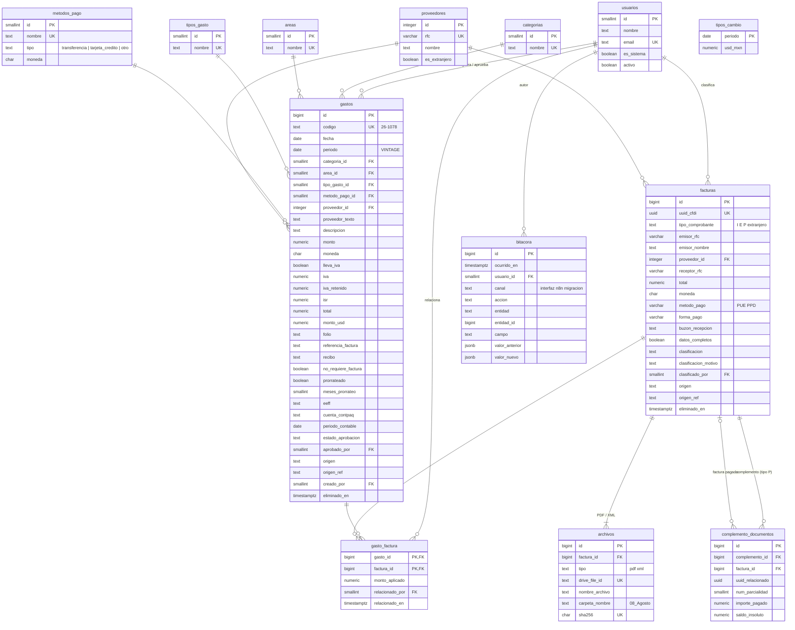

# Modelo de datos — Manejo de Gastos (Atrato)

> **Actualización 11-oct-2026:** se descartó Supabase. El almacenamiento es el **Budget en Google Sheets** (OPEX-CONTA más las
> pestañas FACTURAS, BITACORA, N8N_CORRIDAS, N8N_SAT y MOVIMIENTOS_BANCO) y los bancos vienen de Metabase/read replica.
> Las tablas de abajo siguen siendo el modelo lógico (qué datos existen y cómo se relacionan); la implementación está en `n8n/`.

> Versión 0.1 · 11-oct-2026 · Basado en [SPEC.md](SPEC.md) v0.2 y en la estructura del Budget Opex 2026.
> Tipos de dato en PostgreSQL. La sección 4 explica por qué.
> Lo leen y escriben dos actores: **la interfaz** (equipo de finanzas) y **n8n** (las automatizaciones de los pasos 1–4 del mapa).

---

## 1. Tablas

### Convenciones
- Los catálogos usan `smallint` como llave. Las tablas de movimiento usan `bigint generated always as identity`.
- El dinero va en `numeric(14,2)` (nunca `float`). Los tipos de cambio van en `numeric(12,6)`.
- Las tablas que se editan tienen `creado_en`, `actualizado_en` y `eliminado_en`. **No se borra nada físicamente**: eliminar es poner fecha en `eliminado_en`. La bitácora (SPEC, caso 16) exige poder ver cómo estaba.
- Las tablas que puede escribir n8n tienen `origen` y `origen_ref`, con la restricción `unique (origen, origen_ref)`. Así, si una automatización corre dos veces, no duplica registros.

### 1.1 Catálogos

**`usuarios`**: personas del equipo, más un usuario de sistema para n8n.
| Columna | Tipo | Nota |
|---|---|---|
| id | smallint PK | |
| nombre | text not null | Luis Caloca, Gilberto Retamoza, Álvaro Hernández, Isabel Torres, **n8n** |
| email | text unique | |
| es_sistema | boolean not null default false | `true` para n8n; sirve para distinguir en la bitácora |
| activo | boolean not null default true | |

**`categorias`**: columna *Expense Category* de OPEX-CONTA (pestaña Categorias).
| id smallint PK | nombre text unique not null | activo boolean not null default true |
|---|---|---|

**`areas`**: columna *Area* (General, Finance, Board…).
| id smallint PK | nombre text unique not null | activo boolean not null default true |
|---|---|---|

**`tipos_gasto`**: columna *Expense Type* (Variable, One Time…). Es tabla y no lista fija porque no tengo el catálogo exacto.
| id smallint PK | nombre text unique not null | activo boolean not null default true |
|---|---|---|

**`metodos_pago`**: columna *Payment Method* (BBVA, BBVA USD, Banregio, Clara, Amex…).
| Columna | Tipo | Nota |
|---|---|---|
| id | smallint PK | |
| nombre | text unique not null | Tal como aparece en OPEX-CONTA |
| tipo | text not null check in (`transferencia`, `tarjeta_credito`, `otro`) | **Define el flujo de aprobación**: transferencia se aprueba; tarjeta de crédito solo se revisa |
| moneda | char(3) not null default 'MXN' | BBVA USD → `USD` |
| activo | boolean not null default true | |

**`proveedores`**
| Columna | Tipo | Nota |
|---|---|---|
| id | integer PK | |
| rfc | varchar(13) unique null | `null` para proveedores extranjeros (invoices) |
| nombre | text not null | |
| es_extranjero | boolean not null default false | |
| creado_en | timestamptz not null default now() | |

**`tipos_cambio`**: renglón "Dolar" de la pestaña OPEX.
| periodo date PK (día 1 del mes) | usd_mxn numeric(12,6) not null |
|---|---|

### 1.2 Gastos

**`gastos`**: un renglón de OPEX-CONTA.
| Columna | Tipo | Nota |
|---|---|---|
| id | bigint PK | |
| codigo | text unique not null | `26-1078`, el ID visible |
| fecha | date not null | DATE |
| periodo | date not null | VINTAGE (`01_ENERO` → `2026-01-01`); el texto `01_ENERO` se arma al mostrar |
| categoria_id | smallint FK → categorias null | Puede quedar vacío al registrar y llenarse después |
| area_id | smallint FK → areas null | |
| tipo_gasto_id | smallint FK → tipos_gasto null | |
| metodo_pago_id | smallint FK → metodos_pago not null | |
| proveedor_id | integer FK → proveedores null | Proveedor identificado |
| proveedor_texto | text null | *Provider* tal como viene del banco (por ejemplo "SPEI R…") |
| descripcion | text | |
| monto | numeric(14,2) not null | *Amount*; egreso en negativo, como en el Sheet |
| moneda | char(3) not null default 'MXN' | |
| lleva_iva | boolean not null default false | *VAT ?* |
| iva | numeric(14,2) | |
| iva_retenido | numeric(14,2) | |
| isr | numeric(14,2) | |
| total | numeric(14,2) not null | |
| monto_usd | numeric(14,2) | *USD*; se guarda tal como se capturó, aunque se pueda calcular con `tipos_cambio` |
| usuario_gasto | text | Columna *User* (quién originó el gasto; no es un usuario de la app) |
| folio | text | |
| referencia_factura | text | Columna *Invoice* tal cual, para la migración **[P12]** |
| recibo | text | Columna *Receipt* tal cual |
| no_requiere_factura | boolean not null default false | **Sin factura (no requiere)**. En la migración se marca `true` cuando *Receipt* = "NO FACTURA" |
| motivo_sin_factura | text | |
| prorrateado | boolean not null default false | |
| meses_prorrateo | smallint | |
| provision | text | |
| eeff | text | Rubro de estados financieros (por ejemplo "Resultados…") |
| cuenta_contpaq | text | (por ejemplo `6300-3…`) |
| periodo_contable | date | *Periodo* ("Mayo 26") |
| fluctuacion | numeric(14,2) | |
| notas | text | |
| check_ok | boolean not null default false | *CHECK* **[P10]** |
| estado_aprobacion | text not null check in (`pendiente_aprobacion`, `aprobado`, `rechazado`, `pendiente_revision`, `revisado`) | El valor inicial sale de `metodos_pago.tipo` |
| aprobado_por | smallint FK → usuarios null | |
| aprobado_en | timestamptz null | |
| motivo_rechazo | text null | |
| origen | text not null check in (`historico_budget`, `manual`, `banco`, `correo`, `sat`, `slack`) | |
| origen_ref | text null | ID externo (movimiento bancario, número de renglón del Sheet…) |
| creado_por | smallint FK → usuarios not null | |
| creado_en / actualizado_en / eliminado_en | timestamptz | |

El estado de factura (*Con factura / Falta factura / Sin factura*) **no se guarda**. Se calcula: hay relación en `gasto_factura` → *Con factura*; `no_requiere_factura` → *Sin factura*; si no, *Falta factura*. Guardarlo por separado permitiría que se contradiga con la relación real.

### 1.3 Facturas

**`facturas`**: un CFDI o invoice. Incluye los PDF de Drive que aún no tienen datos.
| Columna | Tipo | Nota |
|---|---|---|
| id | bigint PK | |
| uuid_cfdi | uuid unique null | `null` en invoices extranjeros y en PDF sin datos todavía |
| tipo_comprobante | text null check in (`I`, `E`, `P`, `N`, `T`, `extranjero`) | `P` = complemento de pago |
| serie | text | |
| folio | text | |
| fecha_emision | timestamptz | |
| emisor_rfc | varchar(13) | |
| emisor_nombre | text | |
| proveedor_id | integer FK → proveedores null | |
| receptor_rfc | varchar(13) | Las reglas descartan la factura si es distinto de `ATE1905076I1` |
| subtotal | numeric(14,2) | |
| iva_trasladado | numeric(14,2) | |
| iva_retenido | numeric(14,2) | |
| isr_retenido | numeric(14,2) | |
| total | numeric(14,2) | |
| moneda | char(3) | |
| tipo_cambio | numeric(12,6) | |
| metodo_pago | varchar(3) check in (`PUE`, `PPD`) | |
| forma_pago | varchar(2) | Catálogo SAT (`03` transferencia, `04` tarjeta de crédito…) |
| uso_cfdi | varchar(4) | |
| buzon_recepcion | text | Correo donde llegó; la regla de soportefinanzas@ lo usa |
| datos_completos | boolean not null default false | `false` → la interfaz muestra "sin datos" |
| clasificacion | text not null default `por_clasificar` check in (`por_clasificar`, `por_validar`, `pagar`, `pagar_banregio`, `pagada_tarjeta`, `complemento`, `descartada`, `no_es_factura`) | Resultado de las reglas o del agente (paso 1), o marcado a mano. `pagada_tarjeta`: la factura de tarjeta se da por **ya pagada**, y queda **por conciliar** hasta que se ligue al cargo del estado de cuenta |
| clasificacion_motivo | text | Por qué: regla aplicada o razonamiento del agente |
| clasificado_por | smallint FK → usuarios null | Persona, o el usuario n8n si lo hizo el agente |
| origen / origen_ref | text | Igual que en `gastos` (`drive`, `correo`, `sat`, `manual`…) |
| creado_por, creado_en, actualizado_en, eliminado_en | | |

El estado que se muestra en la carpeta (*Relacionada / Pendiente de pago / Pagada (tarjeta) · por conciliar / Complemento / Descartada / No es factura*) se calcula a partir de `clasificacion` más la existencia de relaciones.

**`archivos`**: los PDF y XML. Una factura puede tener los dos.
| Columna | Tipo | Nota |
|---|---|---|
| id | bigint PK | |
| factura_id | bigint FK → facturas not null | |
| tipo | text not null check in (`pdf`, `xml`, `otro`) | |
| drive_file_id | text unique not null | ID del archivo en Drive |
| nombre_archivo | text not null | Tal como está en Drive (`Telcel $3,228.04`) |
| carpeta_drive_id | text not null | |
| carpeta_nombre | text not null | `08_Agosto`, `Factura uber`… Arma el árbol de la pantalla C |
| sha256 | char(64) unique null | Detecta el mismo archivo subido dos veces |
| tamano_bytes | integer | |
| creado_en | timestamptz | |

**`gasto_factura`**: relación muchos a muchos entre gastos y facturas.
| Columna | Tipo | Nota |
|---|---|---|
| gasto_id | bigint FK → gastos | PK compuesta |
| factura_id | bigint FK → facturas | PK compuesta |
| monto_aplicado | numeric(14,2) null | Cuánto de la factura cubre ese gasto (SPEC caso 3: pagos parciales o una transferencia para varias facturas) |
| relacionado_por | smallint FK → usuarios not null | |
| relacionado_en | timestamptz not null default now() | |

**`complemento_documentos`**: qué facturas paga cada complemento (CFDI tipo P).
| Columna | Tipo | Nota |
|---|---|---|
| id | bigint PK | |
| complemento_id | bigint FK → facturas not null | La factura con `tipo_comprobante = 'P'` |
| factura_id | bigint FK → facturas null | La factura pagada; `null` si todavía no está cargada |
| uuid_relacionado | uuid not null | Viene del XML; permite ligarla después |
| num_parcialidad | smallint | |
| saldo_anterior / importe_pagado / saldo_insoluto | numeric(14,2) | |

### 1.4 Bitácora

**`bitacora`**: solo se agregan renglones; nunca se editan ni se borran.
| Columna | Tipo | Nota |
|---|---|---|
| id | bigint PK | |
| ocurrido_en | timestamptz not null default now() | |
| usuario_id | smallint FK → usuarios not null | Una persona, o n8n |
| canal | text not null check in (`interfaz`, `n8n`, `migracion`) | |
| accion | text not null | creó, editó, relacionó, desrelacionó, aprobó, rechazó, revisó, marcó sin factura, subió factura, eliminó, clasificó |
| entidad | text not null | `gasto`, `factura`, `archivo`, `gasto_factura`… |
| entidad_id | bigint not null | |
| campo | text null | |
| valor_anterior | jsonb null | |
| valor_nuevo | jsonb null | |
| comentario | text null | |

**Recomendación:** que la escriba la base de datos con *triggers* en cada tabla, y no la interfaz o n8n por su cuenta. Así, ningún cambio se escapa de la bitácora, venga de donde venga. Quien escribe se identifica al abrir la conexión: la interfaz manda el usuario que eligió la persona y n8n manda su usuario de sistema.

### 1.5 Vistas (las consultas que comparten la interfaz y n8n)

| Vista | Qué devuelve | La usa |
|---|---|---|
| `v_gastos` | `gastos` + nombres de catálogo + `estado_factura` calculado | Pantalla B (Opex) |
| `v_falta_factura` | Gastos sin relación y sin `no_requiere_factura`, con días de antigüedad | Pestaña B1 |
| `v_pendientes_pago` | Facturas con clasificación `pagar` o `pagar_banregio` (y `por_validar`), sin relación en `gasto_factura` o con saldo sin cubrir | Pestaña B2; n8n paso 4 (Slack) |
| `v_por_conciliar` | Facturas `pagada_tarjeta` que todavía no tienen el cargo del estado de cuenta ligado en `gasto_factura` | Pestaña B3; n8n paso 3 (relacionar con bancos) |
| `v_facturas` | Facturas + estado calculado + archivos + gastos ligados | Pantalla C |
| `v_historial_proveedor` | Por proveedor: número de gastos por método de pago, último método, categoría y área más usadas | Regla "si históricamente va por Banregio"; agente del paso 1 |

---

## 2. Relaciones

1. **`gastos.categoria_id → categorias`**: cada gasto pertenece a una categoría del budget; puede quedar vacía hasta que se clasifique.
2. **`gastos.area_id → areas`**: cada gasto se asigna a un área de la empresa.
3. **`gastos.tipo_gasto_id → tipos_gasto`**: cada gasto es Variable, One Time, etc.
4. **`gastos.metodo_pago_id → metodos_pago`**: cada gasto salió de una cuenta o tarjeta, y su tipo decide si se aprueba o solo se revisa.
5. **`gastos.proveedor_id → proveedores`**: un gasto puede tener identificado a quién se le pagó; si no, queda solo el texto del banco.
6. **`gastos.creado_por` / `aprobado_por → usuarios`**: quién registró y quién aprobó o revisó cada gasto.
7. **`facturas.proveedor_id → proveedores`**: cada factura se liga al proveedor por su RFC de emisor.
8. **`facturas.clasificado_por → usuarios`**: quién clasificó la factura: una persona o n8n (agente).
9. **`archivos.factura_id → facturas`**: cada PDF o XML de Drive pertenece a una factura; una factura puede tener los dos.
10. **`gasto_factura.gasto_id → gastos` y `gasto_factura.factura_id → facturas`**: un gasto puede estar respaldado por varias facturas y una factura puede pagarse en varios gastos, con el monto aplicado en cada relación.
11. **`complemento_documentos.complemento_id → facturas`**: cada complemento de pago (tipo P) apunta a sí mismo como factura.
12. **`complemento_documentos.factura_id → facturas`**: cada parcialidad de un complemento apunta a la factura que paga, o queda pendiente por UUID si aún no está cargada.
13. **`bitacora.usuario_id → usuarios`**: cada cambio registrado tiene un autor. `entidad` + `entidad_id` apuntan al registro cambiado; no hay FK formal porque una misma columna apunta a varias tablas.

---

## 3. Diagrama

---

## 4. ¿Dónde vive cada gasto y cada factura?

### Hoy (Budget Opex 2026 y Drive)

| Dato | Dónde está hoy |
|---|---|
| Gasto | Un renglón en **OPEX-CONTA** (más su copia en OPEX-VIEW), dentro del Google Sheet |
| Datos del CFDI | Repartidos entre **Bizpoint** (CFDI ya ligados a pagos), **FOLIOS MANUALES** y la columna *Invoice* de OPEX-CONTA |
| Archivo de la factura | Un PDF en la **carpeta de Drive** del mes (`08_Agosto/…`), con un nombre libre |
| Relación gasto ↔ factura | Implícita, en la columna *Invoice* y en Bizpoint |

### Recomendación

| Dato | Dónde debe vivir | Razón |
|---|---|---|
| **Gastos, facturas (datos), relaciones, complementos, bitácora, catálogos** | **Una base de datos PostgreSQL** (por ejemplo Supabase), como **única fuente de verdad** | Ver abajo |
| **Archivos PDF y XML** | **Se quedan en Google Drive**, en las mismas carpetas por mes. La base de datos guarda solo `drive_file_id`, nombre y carpeta | El equipo ya trabaja ahí, n8n tiene nodos nativos de Drive, y duplicar archivos crea dos versiones de la verdad |
| **Google Sheet Budget Opex** | Durante la transición, **una salida de solo lectura**: n8n exporta la vista `v_gastos` al Sheet. Deja de ser donde se captura | Los reportes que dependen del Sheet (SUMMARY, CON-ADJ, estados financieros) siguen funcionando mientras se migran |

**Por qué base de datos y no el Sheet como fuente de verdad, pensando en que escriben la interfaz y n8n:**
1. **Dos escritores al mismo tiempo.** En una base de datos, cada inserción o cambio es atómico: o se aplica completo o no se aplica. En un Sheet, n8n y una persona editando al mismo tiempo pueden pisarse o insertar renglones desfasados.
2. **No hay duplicados cuando n8n reintenta.** `uuid_cfdi` único, `drive_file_id` único y `(origen, origen_ref)` único hacen que re-procesar el mismo correo, la misma descarga del SAT o el mismo archivo no cree otro registro. En el Sheet eso se tendría que programar a mano en cada flujo.
3. **La bitácora no se puede saltar.** Con *triggers*, todo cambio queda registrado, venga de la interfaz, de n8n o de alguien conectado directo. En el Sheet, el historial de versiones no dice qué campo cambió de qué valor a cuál, ni sirve para consultar.
4. **Relaciones reales.** Muchos a muchos (gasto ↔ factura), complementos ligados por UUID y "pendientes de pago" son consultas de una línea en SQL. En el Sheet serían fórmulas frágiles.
5. **Rendimiento.** Al intentar leer OPEX-CONTA (~6,000 renglones) desde el navegador para este proyecto, el Sheet no respondió en 45 segundos. Una base de datos responde esas consultas en milisegundos.
6. **n8n tiene nodos nativos de Postgres y Supabase**, igual que de Drive y Slack. La interfaz y n8n leen las **mismas vistas** de la sección 1.5, así que "Pendientes de pago" significa lo mismo para la pantalla y para el mensaje de Slack.

---

## 5. Qué conviene dejar fuera de la base de datos

| Información | Dónde | Por qué |
|---|---|---|
| **Reglas de clasificación** (tarjeta → ya pagada y por conciliar, complementos aparte, soportefinanzas@ → descartar, histórico Banregio, nuevos → validar) y los casos especiales que se vayan agregando | **El archivo de contexto `manejo_gastos.md`**, versionado, que lee directamente el agente del paso 1 en n8n (todavía no existe; se crea con las reglas que ya me diste) | Son **instrucciones en lenguaje natural** para un agente, no datos. Una tabla obligaría a convertir cada regla en columnas (condición, acción) y perdería los matices de los casos especiales que mencionaste. En el archivo se editan como texto y su versión en git funciona como historial |
| **Precedentes** (cómo se resolvieron casos parecidos) | **No se duplican.** Ya están en la base: `facturas.clasificacion` + `clasificacion_motivo` + la bitácora (cuando alguien corrigió al agente). El agente los consulta con `v_historial_proveedor` | Copiarlos al archivo de contexto lo haría crecer sin control y quedaría desactualizado |
| **Archivos PDF y XML** | Google Drive | Ver sección 4 |
| **Catálogo de claves SAT** (forma de pago, uso de CFDI, régimen) | No hacen falta tablas; se guarda la clave y el texto se muestra desde una lista fija | Es un catálogo público del SAT que casi nunca cambia |
| **Presupuesto (CON-FULL, CON-ADJ, SUMMARY), saldos bancarios (BANKS), activos fijos** | **Fuera de este modelo**, se quedan en el Sheet | El SPEC los deja fuera del alcance. Si después se quiere comparar presupuesto contra real en la app, se agrega una tabla `presupuesto (periodo, categoria_id, area_id, monto)` sin cambiar las demás |

---

## 6. Supuestos y preguntas

**Supuestos que tomé (corrígeme si alguno está mal)**
- Un renglón de OPEX-CONTA = un gasto. No separé "movimiento bancario" de "gasto" porque en OPEX-CONTA son lo mismo. Si después la conexión a bancos trae movimientos que no son gasto (traspasos entre cuentas, ingresos), se agrega una tabla `movimientos_bancarios` sin tocar las demás.
- *EEFF* y *Contpaq* se guardan como texto en el gasto y no como catálogo, porque no sé si una cuenta Contpaq siempre corresponde al mismo rubro de EEFF.

**Pregunta que no bloquea el modelo** (ya está en el SPEC)
- **[P12]** Qué guarda la columna *Invoice*: solo cambia cómo se migra el histórico.
